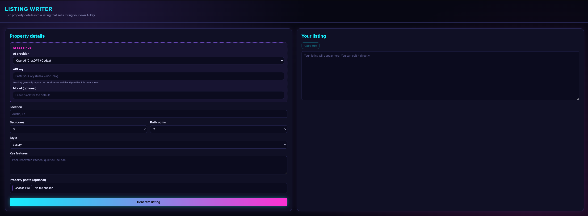

# Listing Writer

Generate real estate listings from property details and an optional photo,
using **your own AI key**. Works with OpenAI, Anthropic (Claude), Google
Gemini, or any OpenAI-compatible service. The listing is editable, with copy
buttons for the text and photo.



## Features

- Pick your AI provider: OpenAI, Claude, Gemini, or a custom OpenAI-compatible URL
- Upload a property photo and the AI works visible details into the listing
- Edit the generated listing directly in the page
- One-click copy for the text and the photo
- Your key stays on your own computer and is never stored

## Setup

1. Clone the repo and enter the folder:
   ```bash
   git clone https://github.com/imababbuilds/listing-writer.git
   cd listing-writer
   ```
2. Create and activate a virtual environment:
   ```bash
   python3 -m venv venv
   source venv/bin/activate        # Windows: venv\Scripts\Activate.ps1
   ```
3. Install dependencies:
   ```bash
   pip install -r requirements.txt
   ```
4. Run it:
   ```bash
   python app.py
   ```
5. Open http://127.0.0.1:5001, choose your provider, and paste your API key
   into the form.

## Using a .env file instead of pasting your key

```bash
cp .env.example .env            # Windows: copy .env.example .env
```

Fill in the key for your provider. If the key field in the page is left
blank, the app uses the one from `.env`.

## Getting an API key

| Provider | Get a key at |
|---|---|
| OpenAI (ChatGPT / Codex) | https://platform.openai.com |
| Anthropic (Claude) | https://console.anthropic.com |
| Google Gemini | https://aistudio.google.com |

A ChatGPT or Claude chat subscription does not include API access. API usage is
billed separately by each provider.

## Custom provider

Choose "Custom (OpenAI-compatible)" to use any service that follows the OpenAI
API format. Enter its base URL (for example `https://example.com/v1`) and your
key for that service.

## Notes

- Your key goes only to the server running on your own computer and then to
  the AI provider. It is never stored.
- Default model names change over time. If one stops working, type a current
  model name into the "Model" field.
- Photos must be under 5 MB.

## License

MIT. See [LICENSE](LICENSE).